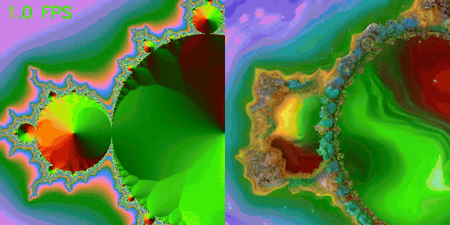

# AIDJ on Mac

AIDJ: realtime AI visuals on Apple Silicon, built on [StreamDiffusion](https://github.com/cumulo-autumn/StreamDiffusion) running with PyTorch MPS.

It runs realtime img2img with [StreamDiffusion](https://github.com/cumulo-autumn/StreamDiffusion) on Apple Silicon, using PyTorch's MPS backend. No CUDA, TensorRT or xformers required.



*Screen recording of `mac_realtime.py` running live in a macOS window on an M2 Max (sd-turbo + TAESD, 384x384, 1 step, about 9 FPS). Left: input, right: StreamDiffusion output; the FPS counter shows the live throughput. A higher-quality MP4 is in [docs/demo.mp4](docs/demo.mp4).*

## What's changed from upstream
- `src/streamdiffusion/pipeline.py`: the CUDA-only timing (`torch.cuda.Event` / `torch.cuda.synchronize`) is replaced with timing that works on any device (`torch.mps.synchronize()` on MPS).
- `mac_realtime.py`: realtime viewer (webcam or video file), recorder and benchmark, running sd-turbo + TAESD in fp16 on MPS.
- `requirements-mac.txt`: dependency versions that work with diffusers 0.24.0.

The original README is kept as [README_ORIGINAL.md](README_ORIGINAL.md).

## Requirements
- Apple Silicon Mac (tested on an M2 Max with 32 GB, macOS 15)
- Python 3.10
- About 6 GB of free disk space for the models (downloaded automatically from Hugging Face)
- Camera permission for your terminal app (System Settings → Privacy & Security → Camera)

## Setup
```bash
git clone https://github.com/shi3z/streamdiffusion_on_mac.git
cd streamdiffusion_on_mac
uv venv -p 3.10 .venv && source .venv/bin/activate
uv pip install -r requirements-mac.txt
uv pip install -e . --no-deps
```

## Usage
```bash
# Webcam → realtime img2img window (input on the left, output on the right)
python mac_realtime.py --size 384 --t 32 --prompt "anime illustration, cel shading"

# Faster / higher quality
python mac_realtime.py --size 256 --t 32      # ~19 FPS
python mac_realtime.py --size 512 --t 35,45   # ~4 FPS, better quality

# Use a video file as input and record the result
python mac_realtime.py --video input.mp4 --record out.mp4 --no-window

# Benchmark only
python mac_realtime.py --bench --input some.png
```

Keys in the window: `q` quits, `p` lets you type a new prompt in the terminal; the change takes effect immediately.

| Option | Description |
|---|---|
| `--prompt` | Text prompt |
| `--size` | Square resolution (256 / 384 / 512) |
| `--t` | `t_index_list`, comma-separated. One value = 1 denoising step. Lower values change the image more |
| `--model` | Hugging Face model ID (default `stabilityai/sd-turbo`) |
| `--camera` | Camera index (default 0) |
| `--video` | Video file to use instead of the webcam |
| `--record` | Save the side-by-side view as an .mp4 file |
| `--no-window` | Don't open a window |

## Benchmark
M2 Max (32 GB), sd-turbo + TAESD, fp16, MPS:

| Size | Steps | ms/frame | FPS |
|---|---|---|---|
| 512 | 2 | 241 | 4.1 |
| 512 | 1 | 156 | 6.4 |
| 384 | 2 | 155 | 6.5 |
| 384 | 1 | 97 | 10.3 |
| 256 | 1 | 53 | 19.0 |

## License
Apache License 2.0, same as upstream [StreamDiffusion](https://github.com/cumulo-autumn/StreamDiffusion).
